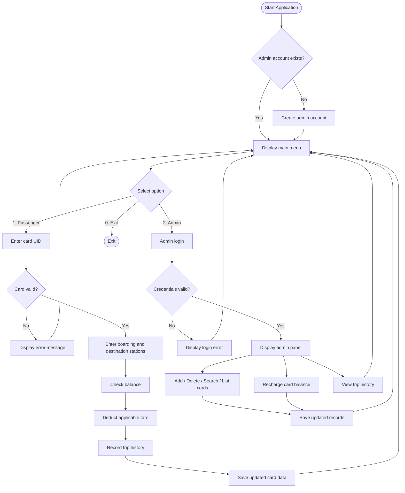

# SmartJatri - Digital Bus Card System


A modular, console-based Digital Bus Card Management System written in C++17. The application simulates a bus fare collection system using unique card identifiers (UIDs). It provides two role-based interfaces:

- **Passenger Interface:** Tap a bus card using its UID, pay the fare, and automatically record trip history.
- **Admin Panel:** Issue and manage cards, recharge balances, monitor card validity, and review passenger trip history.

Originally developed in C for CSE 207 (Data Structures) in May 2025. This repository contains the C++ rewrite.

---

## Table of Contents

- [Features](#features)
- [Technology Stack](#technology-stack)
- [Card Types and Fare Structure](#card-types-and-fare-structure)
- [Project Structure](#project-structure)
- [Data Schema](#data-schema)
- [System Workflow](#system-workflow)
- [Build and Run](#build-and-run)
- [First-Time Usage](#first-time-usage)
- [Design and Implementation](#design-and-implementation)
- [Known Limitations](#known-limitations)
- [Acknowledgments](#acknowledgments)
- [License](#license)

---

## Features

### Passenger Interface

- **UID-based card authentication:** Passengers tap their cards using automatically generated unique identifiers. UIDs are case-insensitive.
- **Automatic fare deduction:** The applicable fare is deducted from the card balance after a successful transaction.
- **Station input:** Passengers enter their boarding and destination stations.
- **Trip recording:** Every successful transaction is stored in the card's trip history.
- **Low-balance warnings:** Displays a warning when the remaining card balance is low.
- **Card validity checks:** Expired cards cannot be used. Passengers also receive a notice when their card is approaching its expiry date.

### Admin Panel

- **First-run account setup:** The program prompts the user to create an admin account on the first launch.
- **Secure login:** Admin authentication uses a salted FNV-1a password hash.
- **Card management:**
  - **Add:** Issue new cards with automatically generated UIDs.
  - **Search:** Find a passenger card and display its details.
  - **List:** Display all registered cards, including balances and expiry dates.
  - **Delete:** Remove an existing card.
- **Balance recharge:** Add money to an existing card.
- **Trip history:** Review the last 10 recorded trips for a particular card.
- **Persistent storage:** Card records, balances, and trip histories are saved to disk and loaded automatically on startup.

---

## Technology Stack

> **Platform note:** The application uses `conio.h` for password masking. This functionality is Windows-specific. On other operating systems, the password is visible while typing.

| Component | Version / Specification | Notes |
| :--- | :--- | :--- |
| Language | C++ | Object-oriented implementation |
| C++ Standard | C++17 | Required compilation standard |
| IDE | Code::Blocks | Project file: `SmartJatri.cbp` |
| Compiler | MinGW-w64 GCC 7+ | Supports the required C++ standard |
| Standard libraries | STL, `<iostream>`, `<fstream>`, `<memory>`, `<string>` | Input/output, file handling, memory management |
| System libraries | `<conio.h>` | Password masking on Windows |

---

## Card Types and Fare Structure

The system supports four passenger card types. Each card type has its own fare and validity period.

| Card Type | Fare (Tk) | Validity | UID Prefix |
| :--- | ---: | :--- | :--- |
| General | 100.00 | 5 years | `G` |
| Student | 50.00 | 2 years | `S` |
| Tourist | 130.00 | 1 month | `T` |
| Child | 50.00 | 5 years | `C` |

**UID generation:** Card identifiers are generated automatically using a type-specific prefix followed by a sequential number.

Examples:

- `G0001` - General card
- `S0001` - Student card
- `T0001` - Tourist card
- `C0001` - Child card

---

## Project Structure

The codebase follows a multi-file, object-oriented architecture. Each module is responsible for a specific part of the application.

```text
SmartJatri/
├── main.cpp                   # Application entry point
├── Utils.h / .cpp             # Input helpers, money formatting, string utilities
├── Date.h / .cpp              # Calendar dates and day-count calculations
├── User.h / .cpp              # Base User class and four card types
├── UserRepository.h / .cpp    # Card records and trip history persistence
├── AdminAuth.h / .cpp         # Admin account and password authentication
├── Kiosk.h / .cpp             # Passenger and admin menus and workflows
├── SmartJatri.cbp             # Code::Blocks project file
├── .gitignore                 # Excludes runtime data and build output
└── README.md                  # Project documentation
```

---

## Data Schema

The application uses text files for persistent storage. Runtime files are created automatically in the program's working directory.

| File | Contents | Purpose |
| :--- | :--- | :--- |
| `users.txt` | Card records and trip history | Stores passenger information, card balances, validity, and trip records |
| `admin.txt` | Admin username, salt, and password hash | Stores administrator authentication data |

> **Security note:** Both files contain personal or credential-related information. They are excluded from version control through `.gitignore` and should never be committed to the repository.

---

## System Workflow

The application starts by checking whether an administrator account already exists. If not, the user is prompted to create one.



---

## Build and Run

### Requirements

- C++14 or later compiler (C++17 recommended).
- MinGW-w64 GCC 7 or newer.
- Code::Blocks (optional, for the IDE build).
- Windows recommended for full password-masking support.

### Option 1: Code::Blocks (recommended)

1. Clone the repository:

   ```bash
   git clone https://github.com/INTE5HAR/SmartJatri.git
   ```

2. Open Code::Blocks and load `SmartJatri.cbp`.
3. Press **Ctrl + F9** to build the project.
4. Press **Ctrl + F10** to run the application.

The project is already configured to use the C++17 standard.

### Option 2: Command Line (GCC / MinGW-w64)

1. Open Command Prompt or PowerShell in the project directory.
2. Compile all source files:

   ```bash
   g++ -std=c++17 -Wall -o smartjatri main.cpp AdminAuth.cpp Date.cpp Kiosk.cpp User.cpp UserRepository.cpp Utils.cpp
   ```

3. Run the executable:

   **Windows:**

   ```bash
   smartjatri.exe
   ```

   **Linux / macOS:**

   ```bash
   ./smartjatri
   ```

   Note: Password masking through `conio.h` is not supported on non-Windows systems.

---

## First-Time Usage

> **Note:** Runtime files (`users.txt` and `admin.txt`) are excluded from version control. The application starts without existing passenger or administrator records.

1. **Create an admin account:** Launch the program. On the first run, you will be prompted to create an administrator username and password.
2. **Access the main menu:** After setup, the application displays the following menu:

   ```text
   =====================================
       Welcome to Digital Bus Card System
   =====================================
       1. Tap card (passenger)
       2. Admin login
       0. Exit
   ```

### Passenger Workflow

1. Select **Option 1** from the main menu.
2. Enter your card UID (for example, `S0001`).
3. Enter your boarding and destination stations.
4. The system validates the card and checks its balance and expiry date.
5. The applicable fare is deducted, and the trip is recorded.

### Admin Workflow

1. Select **Option 2** from the main menu.
2. Enter your administrator credentials.
3. After successful authentication, the admin panel provides the following operations:

| Option | Operation | Description |
| :---: | :--- | :--- |
| 1 | Add user | Issue a new passenger card |
| 2 | Delete user | Remove an existing card (requires `YES` confirmation) |
| 3 | Search user | Display a particular card's details |
| 4 | List all users | Display all registered cards, balances, and expiry dates |
| 5 | Recharge card | Add money to a passenger's card |
| 6 | View trip history | Display the last 10 trips for a card |

---

## Design and Implementation

The project applies several object-oriented programming and data management concepts.

- **Inheritance and polymorphism:** Each card type is implemented as a subclass of the `User` base class. Individual subclasses define their own fare and validity rules. New card types can be introduced by adding another subclass.
- **Encapsulation:** Card-related data and operations are organized within their respective classes.
- **Integer-based currency:** Money is stored as integer paisa (1 Tk = 100 paisa) to avoid floating-point rounding errors during balance calculations.
- **Date calculations:** Card expiry is calculated using exact day counts through `Date::toDays()`.
- **Smart pointers:** Cards are managed using `std::unique_ptr`, allowing automatic memory cleanup and reducing manual memory management.
- **File persistence:** `UserRepository` handles loading and saving passenger records and trip histories.
- **Authentication:** Admin credentials use a salted FNV-1a hash rather than storing plain-text passwords.

---

## Known Limitations

- **Password hashing:** The current implementation uses salted FNV-1a. Although it avoids storing plain-text passwords, FNV-1a is not a password-hashing algorithm and is not suitable for production authentication. A real-world system should use Argon2id, bcrypt, or scrypt.
- **Station management:** Boarding and destination stations are entered as free text. There is no predefined station database, route management, or distance-based fare calculation.
- **Platform compatibility:** Password masking uses `conio.h` and works on Windows only.
- **Admin accounts:** Only one administrator account is supported.
- **UID reuse:** Deleting the most recently issued card and then issuing another card can result in the reuse of its UID.

---

## Acknowledgments

Originally developed as a coursework project for **CSE 207 (Data Structures)** in May 2025 using C.

This repository contains the C++ rewrite, with an object-oriented design and improved code organization.

---

## Author

**Inteshar Alam**

- GitHub: [@INTE5HAR](https://github.com/INTE5HAR)

---

## License

No license has been selected yet. Until a license is added, the default copyright rules apply. Add a `LICENSE` file to explicitly define the permissions and conditions for using, modifying, and distributing this project.
